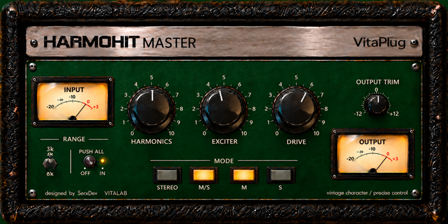

# Compañero, MASTER R1 está implementado como candidato local en [harmohit-master](..), conservando el historial y sin remoto.

- AU y VST3 macOS arm64 compilados; CTest aprobado.
- Tres bancos independientes STEREO/MID/SIDE, estado persistente y nuevo DRIVE progresivo.
- HARMONICS/EXCITER: 63 configuraciones comparadas con MIX, error máximo **0**.
- MIX y MASTER cargados simultáneamente en el host VST3 de prueba.
- MIX original intacto. Sin commits, pushes, Releases ni instalaciones.

Captura auténtica del editor JUCE, editando MID:

**No doy R1 por cerrado:** quedan diferencias visuales en RANGE y piezas reutilizadas, evaluación musical del DRIVE y smoke físico en Logic/Pro Tools. También documento el ringing del sobremuestreo heredado y la discrepancia entre la escala impresa del trim y su rango.

El [informe completo](MASTER_R1_REPORT.md) incluye archivos, identificadores, arquitectura, mediciones, limitaciones e instrucciones del smoke en Logic.