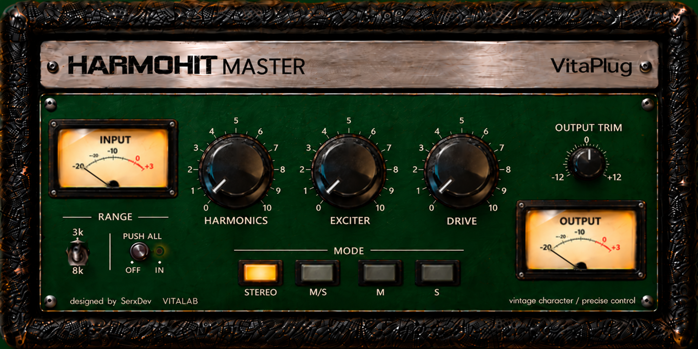

# VitaPlug HARMOHIT MASTER

**v0.2.0 — R2 · Motor DRIVE 670**

Procesador de coloración y dinámica para mastering, en formato AU/VST3. Tiene tres motores: HARMONICS, EXCITER y DRIVE 670. Trabaja en modo STEREO o en Mid/Side, con bancos de parámetros independientes, y termina en un OUTPUT TRIM manual.



*Render del componente editor real de la versión v0.2.0 (captura fuera de pantalla del plugin, a 2×, con los parámetros por defecto). No es una captura de Logic ni un diseño alternativo. Es idéntico píxel a píxel a la interfaz R1.2 aprobada.*

---

## 1. Qué es

HARMOHIT MASTER es la versión de mastering de VitaPlug HARMOHIT. Mantiene el carácter armónico de HARMOHIT MIX y añade lo que necesita un bus de mastering:
- procesamiento Mid/Side con bancos independientes;
- un DRIVE con compresión variable-mu y coloración;
- un control final de nivel en manos del ingeniero.

## 2. Filosofía Vitalab

- **Criterio musical primero.** Cada motor se aprueba escuchando música real en un DAW, no solo con medidas.
- **Medidas que sostienen las decisiones.** Toda la historia del DRIVE, incluidas dos versiones descartadas, está documentada con sus pruebas en `Documentation/`.
- **Pocos mandos, mucho criterio.** Un solo DRIVE gobierna compresión, color y ganancia. No hay mandos de umbral, ataque ni ratio.
- **El nivel final es del ingeniero.** No hay limitador, normalización ni compensación automática.

## 3. HARMOHIT MIX frente a HARMOHIT MASTER

| | HARMOHIT MIX | HARMOHIT MASTER |
|---|---|---|
| Uso | Pistas y buses de mezcla | Bus de mastering |
| HARMONICS / EXCITER | Algoritmo MIX | El mismo algoritmo, equivalente bit a bit con DRIVE 0 |
| DRIVE | Saturación creativa con ganancia | DRIVE 670: compresión variable-mu, coloración y POST GAIN |
| Modos | Estéreo | STEREO y M/S, con bancos STEREO, MID y SIDE independientes |
| Identificadores AU | `aufx / HhMx / Vtpl` | `aufx / HmR1 / Vtpl` |

Ambos plugins pueden convivir en la misma sesión.

## 4. Arquitectura

```
L/R ─► banco STEREO (L/R enlazados) ──────────────┐
    └► M/S ─► banco MID (independiente) ──────────┼─► decodificación M/S + fundido de modo ─► OUTPUT TRIM ─► salida
          └─► banco SIDE (independiente) ─────────┘

Cada banco, en su propio dominio sobremuestreado 4×:
  dry ─► HARMONICS ─► EXCITER ────────────────► contribución H/E (coloured − dry)
  dry ─► DRIVE 670 (variable-mu, color, POST GAIN) ─► p670
  salida del banco = p670 + (coloured − dry)
```

DRIVE trabaja **en paralelo** con HARMONICS/EXCITER:
- el seco nunca se suma dos veces;
- las tres ramas están alineadas exactamente porque comparten la misma muestra sobremuestreada;
- HARMONICS y EXCITER no pasan por el compresor ni por el POST GAIN.

Detalles en [Documentation/MASTER_R2_TECHNICAL.md](Documentation/MASTER_R2_TECHNICAL.md).

## 5. HARMONICS

Modelado espectral de tres estantes de primer orden (cuerpo, presencia y aire), con un macro progresivo. Es exactamente el comportamiento de HARMOHIT MIX.

## 6. EXCITER

Excitación aural por bandas: presencia en 3 kHz o brillo en 8 kHz con **RANGE**, o ambas con **PUSH ALL**. Los cambios de banda se funden sin discontinuidades. Es exactamente el comportamiento de HARMOHIT MIX.

## 7. DRIVE 670

Un macroprocesador de un solo mando. Está **inspirado** en el comportamiento variable-mu y en la coloración de compresores clásicos de válvulas como el Fairchild 670. **No es una emulación del hardware** ni está afiliado a sus fabricantes (véase §15).

- **Compresión variable-mu.** La ganancia baja de forma exponencial con la tensión de control y la distorsión crece con la reducción de ganancia, como en las válvulas de corte remoto. La detección es por **realimentación**, con enlace estéreo en el banco STEREO.
- **Coloración.** Una etapa de salida push-pull aporta armónicos pares e impares que aparecen aunque la compresión sea mínima. Un transformador de salida satura la zona grave.
- **Tres regímenes por posición del mando:**

| DRIVE | Régimen | Ataque / recuperación de referencia |
|---|---|---|
| 1–3 | TC5 | 0,2 ms; recuperación dependiente del programa (≈ 2 s en picos aislados, hasta 10 s con carga sostenida) |
| 4–7 | TC3 | 0,4 ms / 2 s |
| 8–10 | TC2 | 0,2 ms / 0,8 s |

- **POST GAIN:** +1 dB por paso, de +0 a +10 dB, aplicado después de toda la compresión y la coloración. **DRIVE empuja el nivel a propósito.** Los valores pueden superar 0 dBFS dentro del procesamiento en coma flotante. Bajar el nivel con OUTPUT TRIM es responsabilidad del ingeniero.
- **DRIVE 0** desactiva por completo el procesamiento de DRIVE.
- **Mando:** el parámetro va de 0 a 100 y se muestra de 0 a 10. Internamente se usan 11 pasos enteros (redondeo con una pequeña histéresis). El "7" impreso corresponde al paso 7.

**Nivel de entrada** (en la entrada de cada banco):
- **Verificado:** los objetivos de reducción de ganancia se calibraron con una mezcla de referencia a **−18 dBFS RMS**. En pasajes fuertes son 0,5 / 1 / 1,5 dB con DRIVE 1–3, 2 a 3 dB con DRIVE 4–7 y 3,5 / 4,2 / 5 dB con DRIVE 8–10.
- **Provisional:** se recomienda trabajar entre **−20 y −14 dBFS RMS**. Es una referencia preliminar, no una restricción. Con más nivel hay más compresión y más color impar; con menos nivel, el DRIVE se acerca a color sin compresión.

## 8. STEREO y M/S

- **STEREO:** un banco procesa L/R con un único detector enlazado, lo que preserva la imagen.
- **M/S:** la señal se codifica en Mid y Side. Cada componente pasa por su propio banco y después se reconstruye L/R. **MID y SIDE se procesan siempre a la vez.** Los botones **M** y **S** solo eligen qué banco se edita en la interfaz.

### Flujo de mastering Mid/Side

Un flujo aprobado en escucha real:
- **MID:** DRIVE 670 para el control dinámico, la cohesión y el color del centro (bombo, bajo, voz).
- **SIDE:** HARMONICS y EXCITER para enriquecer la información lateral.

En la escucha de validación produjo control dinámico, transitorios musicales y una apertura estéreo notable. Es un ejemplo, no un preset ni una receta universal. Explicación, riesgos (exceso de Side y compatibilidad mono) y comprobaciones recomendadas en [Documentation/MID_SIDE_MASTERING_WORKFLOW.md](Documentation/MID_SIDE_MASTERING_WORKFLOW.md).

## 9. Bancos independientes

STEREO, MID y SIDE tienen cada uno su HARMONICS, EXCITER, RANGE, PUSH ALL y DRIVE, y su propio motor DRIVE 670: detector, memoria, color, POST GAIN y rampas. Ningún estado se comparte entre bancos. Los tres siguen activos para que los cambios de modo no produzcan clics.

## 10. OUTPUT TRIM

Ganancia global manual de −24 a +12 dB, al final de la cadena. Entre el POST GAIN y el OUTPUT TRIM solo hay operaciones lineales en coma flotante, así que cualquier exceso puede bajarse sin muestras recortadas. El plugin no tiene limitador ni clipper.

## 11. Compilación

Requisitos:
- macOS con Xcode o Command Line Tools;
- CMake ≥ 3.22;
- JUCE **9.0.3**, no incluido en el repositorio. La ruta se indica con `JUCE_DIR`.

```sh
cmake -S . -B build -DCMAKE_BUILD_TYPE=Release -DCMAKE_OSX_ARCHITECTURES=arm64 \
      -DJUCE_DIR=/ruta/a/JUCE-9.0.3
cmake --build build --config Release -j8
ctest --test-dir build --output-on-failure
```

- Los artefactos quedan en `build/VitaPlugHarmoHitMasterR1_artefacts/Release/{AU,VST3}`. Compilar no instala nada.
- `HarmoHitMasterTests` y `HarmoHitDriveTests` se compilan siempre.
- La batería de equivalencia frente al prototipo DRIVE 670 LAB (`HarmoHitDrive670IntegrationTests`) solo se compila si existe el proyecto de laboratorio en `DRIVE670_LAB_DIR` (no publicado). Además usa material de audio privado que no está en el repositorio.

## 12. Instalación

Los binarios de cada versión se publican como assets del [Release](../../releases) cuando su distribución está autorizada (§15).
- AU: `~/Library/Audio/Plug-Ins/Components/`
- VST3: `~/Library/Audio/Plug-Ins/VST3/`

Los binarios están firmados **ad hoc**: no tienen firma Developer ID ni notarización de Apple. El paquete incluye instrucciones para instalarlos sin desactivar Gatekeeper de forma global. En Logic, después de instalar, usa Gestor de plug-ins, "Restablecer y volver a analizar selección".

## 13. Compatibilidad verificada

| Plataforma | Estado |
|---|---|
| macOS 26.5, Apple Silicon (M5), arm64 | Compilado y probado |
| Logic Pro 12.4, AU | Prueba de escucha real del usuario; `auval` superado |
| VST3, arm64 | Compilado y cargado en un host de pruebas JUCE junto a HARMOHIT MIX; **no probado todavía en un DAW** |
| 44,1, 48 y 96 kHz | Probado (batería automática) |
| macOS Intel (x86_64) | **No compilado ni probado** |
| Windows | **No probado.** El workflow heredado de MIX está desactivado |

## 14. Limitaciones conocidas

- **CPU:** unos 6,3 % de un núcleo a 48 kHz (M5), porque los tres bancos ejecutan DRIVE 670 siempre. R1.2 consumía 3,2 %.
- **Calibración SIDE provisional:** referencia de operación de +15 dB, pendiente de una escucha específica de DRIVE en el Side.
- **Puntero del mando:** está desplazado unos 3° respecto al ángulo programado. Es un rasgo preexistente de la interfaz congelada.
- **Sesiones anteriores a R2:** recuperan el valor de DRIVE pero suenan distinto, porque el motor ha cambiado. Abre siempre una copia y revisa el nivel de salida antes de reproducir (§16).
- **Distribución:** solo arm64, sin notarizar.

## 15. Créditos, licencias y marcas

- **Diseño, dirección musical y aprobación:** SerxDev — VitaPlug / Vitalab.
- **Código e imágenes de HARMOHIT MASTER:** © 2026 Sergio Devece Carañana (SerxDev). El repositorio es público para estudio y presentación. **No incluye licencia** por decisión explícita del propietario: la visibilidad pública no concede derechos de reutilización ni redistribución, y el código **no** está bajo AGPLv3.
- **JUCE 9.0.3** (Raw Material Software): los binarios publicados usan JUCE bajo la **licencia comercial JUCE 9 Starter** (gratuita, desarrollador individual sin ingresos por software JUCE), no bajo AGPLv3. JUCE no se incluye en el repositorio. Quien compile el código necesita su propia licencia de JUCE.
- **Componentes de terceros** compilados en los binarios: VST3 SDK (MIT), AudioUnitSDK (Apache-2.0), zlib, libpng, libwebp, FLAC, Ogg/Vorbis, Opus, HarfBuzz, SheenBidi, LunaSVG y PlutoVG, cada uno con su licencia. Avisos completos en [Documentation/THIRD_PARTY_NOTICES.txt](Documentation/THIRD_PARTY_NOTICES.txt) y detalle en [Documentation/THIRD_PARTY_AND_PUBLICATION.md](Documentation/THIRD_PARTY_AND_PUBLICATION.md).
- **Marcas:** "Fairchild" y "Fairchild 670" son marcas de sus respectivos titulares. Se citan solo como referencia técnica. VitaPlug HARMOHIT MASTER es un producto independiente, sin afiliación, patrocinio ni respaldo. AU y VST son marcas de Apple y Steinberg respectivamente.

## 16. Historial de versiones

| Versión | Contenido |
|---|---|
| **v0.2.0 (R2)** | Nuevo motor DRIVE 670 (variable-mu, tres regímenes y POST GAIN), integrado bit a bit desde el prototipo aprobado. Calibración por banco y mapeo del DRIVE a pasos. Interfaz idéntica a R1.2. Aprobado en escucha real en Logic. |
| R1.2 | DRIVE adaptativo con rodilla referida al programa. Descartado tras la escucha. |
| R1.1 | Diagnóstico de DRIVE y auditoría independiente (R12). |
| R1 | Primera versión MASTER: bancos STEREO/MID/SIDE, HARMONICS y EXCITER de MIX, interfaz definitiva. |
| ≤ 0.1.0 | Historial heredado de HARMOHIT MIX, conservado en Git. |

Notas completas en [CHANGELOG.md](CHANGELOG.md).

**Cambio de sonido entre R1.2 y R2:** el parámetro DRIVE conserva su identificador y su rango, pero su motor y su significado son nuevos. Una sesión antigua con DRIVE a 70 aplica ahora +7 dB de POST GAIN además de compresión. Prueba primero sobre copias de tus sesiones y no sobrescribas presets antiguos.
